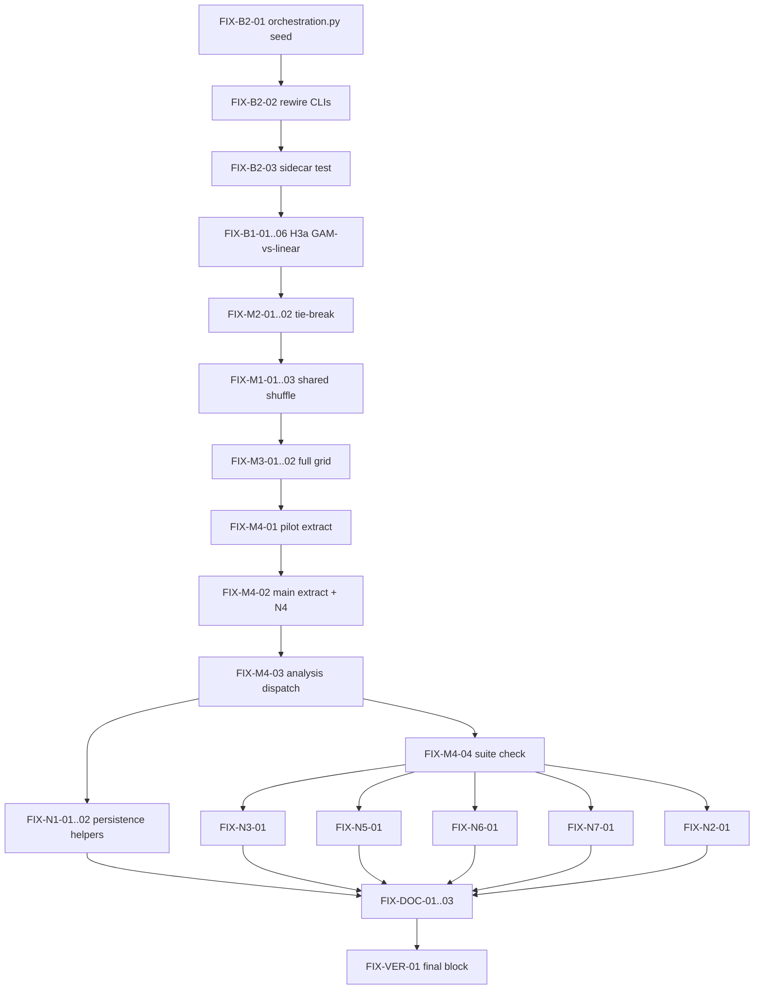

# Fix plan — code review remediation

**Source:** CODE_REVIEW_REPORT.md (2026-07-14) · **User scope:** B1–B2, M1–M4, N1–N7 (locked 2026-07-14) · **Target:** pilot + main-study ready
**Charter precedence:** `03_Methods.tex` + `WORKING.md` > `IMPLEMENTATION_PLAN.md` > report prose.
**Out of scope:** git commit/push (user decides), Methods LaTeX edits (WORKING §2 rows OK), Doug D6 structured output, rewriting `gate.py` or broad `networks.py` refactor.

## Executive summary

- **Two blockers are fixed first and together seed the M4 refactor:** B2 (`code_commit="pilot"` literal in every pilot/main sidecar) is fixed by creating `convention_topology/orchestration.py` with a shared `get_code_commit()` + `build_run_config()` that all three CLIs use — the same extraction that M4 later completes. B1 replaces H3a's wrong primary test (linear vs. intercept-only) with the Methods-locked **GAM-vs-linear** LR test.
- **Majors restore doc/code consistency:** M2 unifies the incumbent tie-break on one lexicographic helper in `tracker.py`; M1 adds a `shared_shuffle` flag so Phase 2 matches Ashery `committed()`'s once-per-interaction option shuffle; M3 makes H3b's confirmatory check see zero-count cells over the full `(topology × cm_k)` grid.
- **M4 finishes the thin-CLI extraction incrementally** (pilot → main → analyze), keeping tests green at each step; `run_pilot.py` / `run_main.py` / `analyze.py` end as argparse + one call.
- **Minors N1–N7 all land** (none deferred): persistence write/delete helpers (N1), `networks.py` minority_size guard ≤3 lines (N2), glob-path reuse in `analysis/common.py` (N3), single `_options` source (N4, falls out of M4), Phase-2 length guard raising `ValueError` (N5), dependency pins aligned to IMPLEMENTATION_PLAN §7.2 (N6), typed fit-failure exceptions with JSON `reason` (N7).
- **Every phase ends with the full verification block** (unittest + coverage ≥85 + all CLI smokes + secrets grep); docs (WORKING §2, IMPLEMENTATION_PLAN, CODE_REVIEW_REPORT remediation table) updated in Phase 5.

## Todo checklist

| ID | Finding | Files | Steps | Tests | Verify |
| --- | --- | --- | --- | --- | --- |
| FIX-B2-01 | B2 | `convention_topology/orchestration.py` (new), `run_one.py` | Create `orchestration.py`; move from `run_one.py`/`run_pilot.py`: `_code_commit`→`get_code_commit()`, `GridCell`, `_rewards`/`_options`, `_build_run_config`→`build_run_config()` (sets `code_commit=get_code_commit()`, **never** a literal), `_build_client`→`build_client()`, `_retry_policy_for`→`retry_policy_for()` | existing `test_orchestration.py` imports updated; new unit: `build_run_config(...).code_commit` matches `git rev-parse --short HEAD` output (or `"unknown"` fallback) | suite green |
| FIX-B2-02 | B2 | `run_one.py`, `run_pilot.py`, `run_main.py` | All three CLIs import the shared symbols from `orchestration`; delete the duplicated `_build_run_config`/`_code_commit`/`_build_client`/`_retry_policy_for` definitions; `run_main.py` stops importing privates from `run_pilot` | import-level smoke via existing CLI tests | `run_pilot.py --dry-run`, `run_main.py --dry-run` |
| FIX-B2-03 | B2 | `tests/test_orchestration.py` | **Integration test:** run a 1-cell mock pilot batch into a tmp dir; read the produced `.meta.json`; assert `code_commit` equals the real short HEAD (or `"unknown"`), and `!= "pilot"` | new test (would have caught B2) | suite green |
| FIX-B1-01 | B1 | `convention_topology/analysis/h3a.py` | Implement **primary** GAM-vs-linear LR: fit `sm.Logit(y, add_constant(x))` and `pygam.LogisticGAM(s(0, n_splines=...))`; `lr_stat_gam_vs_linear = 2*(ll_gam − ll_linear)` via deviance/log-likelihood; `df = edof_gam − 2` (document as approximate spline LR df in docstring); `lr_p_gam_vs_linear = chi2.sf(stat, df)`. Matches `03_Methods.tex:228-229` / `WORKING.md:385` | see FIX-B1-05 | `analyze.py --h3a --model mock` |
| FIX-B1-02 | B1 | `h3a.py` | Demote intercept contrast: rename `lr_stat_vs_intercept`/`lr_p_vs_intercept` → `lr_stat_linear_vs_intercept`/`lr_p_linear_vs_intercept`; docstring marks them **secondary/descriptive** — never the H3a claim | field-name assertions in `test_analysis.py` | — |
| FIX-B1-03 | B1 | `h3a.py` | Add `flip_curve` to output JSON: GAM predicted flip probability over `k = 1..6` grid (figure data source) | curve length/monotonic-domain test | JSON inspect |
| FIX-B1-04 | B1 | `h3a.py` | `label = "confirmatory"` **only if** GAM fit **and** the GAM-vs-linear LR both succeed; any fit failure → `"exploratory"` + `reason` (ties into N7 typed exceptions) | degenerate-n fixture → exploratory | — |
| FIX-B1-05 | B1 | `tests/test_analysis.py` | New H3a tests: (a) clean sigmoidal fixture → `lr_stat_gam_vs_linear`/`lr_p_gam_vs_linear`/df present and finite; (b) renamed intercept fields present; (c) tiny/degenerate n → exploratory dict, no crash; (d) `flip_curve` present on success | new tests | suite green |
| FIX-B1-06 | B1 | `IMPLEMENTATION_PLAN.md` §7.9 (~line 585) | Rewrite the "Practical H3a lock" note: primary = GAM vs. linear LR; linear-vs-intercept descriptive only (root cause of B1 — prevents reintroduction) | — | doc review |
| FIX-M2-01 | M2 | `convention_topology/tracker.py`, `convention_topology/dvs.py` | Move `_modal_lexicographic` to `tracker.py` (single definition); `tracker.modal_label_in_window` uses it (replaces `Counter.most_common(1)` insertion-order tie-break); `dvs` imports it from `tracker` — `dvs.incumbent_label` behavior unchanged | existing `test_dvs.py::test_tie_break_is_lexicographic` still green | suite green |
| FIX-M2-02 | M2 | `tests/test_run_integration.py` (or `test_dvs.py`) | Tests: (a) exact tie at gate → production `modal_label_in_window` returns lexicographic winner; (b) integration: sidecar `incumbent_label` from a real (mock) run == `dvs.incumbent_label(tracker, t_gate)` (would have caught M2) | new tests | suite green |
| FIX-M1-01 | M1 | `convention_topology/simulation.py`, `convention_topology/run.py` | Add `shared_shuffle: bool = False` to `make_interaction_step`; when `True`, shuffle options **once per interaction** before the player loop (both agents see the same order — Ashery `committed()` fidelity); `run.py` passes `shared_shuffle=True` for the Phase 2 step, `False` (default) for Phase 1 | see FIX-M1-02 | suite green |
| FIX-M1-02 | M1 | `tests/test_run_integration.py` | Tests with a prompt-capturing fake client: Phase 2 interaction → both agents' prompts built from the same shuffled order; Phase 1 → per-agent shuffles remain independent | new tests | suite green |
| FIX-M1-03 | M1 | `WORKING.md` §2 | Update fidelity/deviations table: Phase 2 shuffle = shared per interaction (upstream fidelity restored); Phase 1 = per-agent (matches Ashery `population()`) | — | doc review |
| FIX-M3-01 | M3 | `convention_topology/analysis/h3b.py`, `analysis/dispatch.py` (Phase 3) | `_is_confirmatory(df, expected_topologies, expected_ks)`: build the full expected `(topology × cm_k)` grid; any zero-count cell → `False`. `h3b_analysis` accepts the expected grid; caller passes observed-design topologies + `k ∈ {1..6}` | see FIX-M3-02 | `analyze.py --h3b --model mock` |
| FIX-M3-02 | M3 | `tests/test_analysis.py` | Tests: (a) one `(topology, k)` cell entirely absent (zero rows) → `label != "confirmatory"` even if all observed cells ≥8; (b) full grid ≥8/cell → confirmatory | new tests (would have caught M3) | suite green |
| FIX-M4-01 | M4 | `orchestration.py`, `run_pilot.py` | Move `pilot_grid`, `_existing_status`→`existing_status`, `run_cell`, `run_batch` (incl. resume/`--retry-failed` filtering + `ThreadPoolExecutor` dispatch) into `orchestration.py`; add `orchestration.run_pilot(config, model_spec, *, data_dir, logs_dir, mock_policy, workers, retry_failed)`; `run_pilot.py` = argparse + that one call | `test_orchestration.py` imports repointed; behavior unchanged | `run_pilot.py --model mock` full batch |
| FIX-M4-02 | M4 | `orchestration.py`, `run_main.py` | Move `cell_targets`, `run_cell_targeted` into `orchestration.py`; add `orchestration.run_main_study(...)` (loops targets, per-topology filter); `run_main.py` = argparse + one call; inline `list(config.params.options_set[0])` at old `run_main.py:86` replaced by shared `build_run_config`/`_options` path (**closes N4**) | existing targeting tests repointed | `run_main.py --model mock --dry-run` |
| FIX-M4-03 | M4 | `convention_topology/analysis/dispatch.py` (new), `analyze.py` | Move `run_h1`…`run_h4`, `run_eligibility`, `run_cross_model`, output-path helpers into `dispatch.py`; add `dispatch.run_all(...)`; `analyze.py` = argparse + dispatch calls | `test_analysis.py` imports repointed | `analyze.py --all --model mock` |
| FIX-M4-04 | M4 | `tests/` | Confirm no CLI file is imported by another CLI or by `convention_topology/`; full suite + coverage after each of M4-01…03 (incremental, each step test-green) | full suite | coverage ≥85 |
| FIX-N1-01 | N1 | `convention_topology/persistence.py` | Add `write_analysis_json(path, payload)`, `write_analysis_csv(path, df)`, `delete_run_artifacts(paths: RunPaths)` (unlinks meta + pickle, `missing_ok=True`) — preferred option; §0 principle 3 stays intact | unit tests for all three helpers | suite green |
| FIX-N1-02 | N1 | `analysis/dispatch.py`, `orchestration.py` | Dispatch uses `write_analysis_json`/`write_analysis_csv` (replaces `analyze.py:26-29` `_write_json` + `:80` `to_csv`); retry-failed cleanup in `run_batch`/`run_cell_targeted` uses `delete_run_artifacts` (replaces direct `unlink` at old `run_pilot.py:168-169` / `run_main.py:83-84`). No change to live-monitor read paths | existing output-file tests | `analyze.py --all --model mock` |
| FIX-N3-01 | N3 | `convention_topology/analysis/common.py` | `_run_dvs(meta, data_dir, meta_path=None)`: `load_run_table` passes each glob-found path from `scan_meta_paths`; pickle path derived from that path (`with_suffix` chain), not reconstructed from `model_shorthand/topology/run_id` strings | test: sidecar in a non-standard subdir still yields pickle DVs (fails pre-fix) | suite green |
| FIX-N4-01 | N4 | `run_main.py` / `orchestration.py` | Verification todo (fix lands inside FIX-M4-02): grep confirms no CLI inlines `options_set[0]`; client options always come from the same `_options(config)` used by `build_run_config` | one-line assertion in orchestration tests (or rely on existing) | grep clean |
| FIX-N5-01 | N5 | `convention_topology/dvs.py` | In `flip` and `time_to_flip`: if `len(tracker["answers"]) < t_start + window` → **raise `ValueError`** (chosen over sentinel — misconfiguration must be visible); document in both docstrings | tests: short Phase 2 → `ValueError`; boundary `len == t_start + window` → no raise | suite green |
| FIX-N6-01 | N6 | `requirements.txt` | Align to IMPLEMENTATION_PLAN §7.2: `networkx>=3.6,<4`, `PyYAML>=6.0.3,<7`, `munch>=4.0,<5`; confirm `scipy>=1.14,<1.17`, `pygam==0.12.0`, `pandas>=2.2,<3` untouched | `pip install -r requirements.txt` resolves; suite green | pip check |
| FIX-N7-01 | N7 | `convention_topology/analysis/h3a.py`, `h3b.py` | Replace bare `except Exception` (old `h3a.py:40,52`, `h3b.py:59`) with narrow tuple: `(np.linalg.LinAlgError, statsmodels.tools.sm_exceptions.PerfectSeparationError, ValueError)`; on catch, set JSON `reason` string on the exploratory path (no silent `None`s) | tests: degenerate n → exploratory dict with `reason`, not crash; a non-fit `TypeError` propagates | suite green |
| FIX-N2-01 | N2 | `convention_topology/networks.py`, `WORKING.md` §2 | **Minimal touch (≤3 lines, no rewrite):** guard at top of `get_interaction_network` — `if minority_size != 0: raise NotImplementedError("CM assignment goes through simulation.swap_committed; minority_size is a dead upstream path")`; remove nothing else. WORKING §2 note: `minority_size` branch unused, CM via `swap_committed` only | tests: `minority_size=1` raises; `execute_run` path (always `minority_size=0`) unaffected | suite green |
| FIX-DOC-01 | docs | `WORKING.md` | §2: M1 shuffle row (FIX-M1-03) + N2 dead-path note; §12: note that the commit pin (`10912a6`) predates the implementation and must be refreshed once the user commits | — | doc review |
| FIX-DOC-02 | docs | `IMPLEMENTATION_PLAN.md` | §7.9 H3a note (FIX-B1-06); module inventory gains `orchestration.py` + `analysis/dispatch.py`; §0 principle 3/6 statements now literally true — no scope-narrowing needed | — | doc review |
| FIX-DOC-03 | docs | `CODE_REVIEW_REPORT.md`, `README.md` | Append remediation status table (template below) to CODE_REVIEW_REPORT.md; refresh README implementation-status rows touched by M4 module moves | — | doc review |
| FIX-VER-01 | all | repo | Run the full post-fix verification block (below) at the end of **each** phase, not only at the end | — | all commands exit 0 |

## Dependency DAG



Phases: **1** Blockers (B2 → B1) · **2** Majors (M2 → M1 → M3) · **3** M4 finish (pilot → main → analyze) · **4** Minors (N1, N3, N5, N6, N7, N2; N4 inside M4-02) · **5** Docs + remediation table. Each phase ends with the verification block.

## Per-finding acceptance criteria

- **B1:** `h3a.json` contains `lr_stat_gam_vs_linear`, `lr_p_gam_vs_linear`, documented df, and `flip_curve`; intercept contrast only under `*_linear_vs_intercept` names, documented secondary; small-n GAM failure → `label="exploratory"` + `reason`; matches `03_Methods.tex:228-229` with **no LaTeX change**.
- **B2:** every sidecar produced via `run_pilot.py`/`run_main.py`/`run_one.py` records the real `git rev-parse --short HEAD` (or `"unknown"` outside a repo); literal `"pilot"` impossible; integration test proves it on a batch-produced sidecar.
- **M1:** Phase 2 interactions shuffle options once, shared by both players (Ashery `committed()` fidelity); Phase 1 per-agent shuffle unchanged; WORKING §2 table documents both.
- **M2:** exactly one modal-with-lexicographic-tie-break implementation (in `tracker.py`); production `incumbent_label`/`committed_to` and `dvs.incumbent_label` provably agree on ties (integration test).
- **M3:** a fully-empty expected cell can never yield `label="confirmatory"`; expected grid supplied by the caller (topologies × k 1..6).
- **M4:** each CLI = argparse + one orchestration/dispatch call; no CLI imports another CLI; `orchestration.py` + `analysis/dispatch.py` hold the moved symbols listed above; behavior byte-identical (tests unchanged except import paths).
- **N1:** all analysis-output writes and run-artifact deletions route through `persistence.py`; live-monitor read paths untouched.
- **N2:** ≤3-line guard only; `minority_size=1` raises `NotImplementedError`; nothing else in `networks.py` changes.
- **N3:** DVs are computed from the exact meta path the glob found; a relocated sidecar no longer silently loses its pickle DVs.
- **N4:** no CLI inlines `options_set[0]`; single `_options` source.
- **N5:** short-Phase-2 misconfiguration raises `ValueError` from `flip`/`time_to_flip`; boundary case (exactly enough interactions) does not raise.
- **N6:** `requirements.txt` matches IMPLEMENTATION_PLAN §7.2 verbatim for networkx/PyYAML/munch; Phase-F pins unchanged.
- **N7:** no bare `except Exception` in `h3a.py`/`h3b.py`; exploratory JSON carries `reason`; unexpected exception types propagate.

## Docs to update

1. `WORKING.md` §2 — M1 shared-shuffle row, N2 dead-path note (FIX-M1-03, FIX-N2-01, FIX-DOC-01)
2. `WORKING.md` §12 — commit-pin staleness note (FIX-DOC-01)
3. `IMPLEMENTATION_PLAN.md` §7.9 — corrected H3a lock (FIX-B1-06); module inventory + §5 test matrix rows for `orchestration.py` / `analysis/dispatch.py` (FIX-DOC-02)
4. `CODE_REVIEW_REPORT.md` — remediation status table appended (FIX-DOC-03)
5. `README.md` — module/status rows touched by M4 (FIX-DOC-03)

## Post-fix verification (run at end of every phase)

```bash
cd "Master Thesis/02_Topic/Experiment_Code/llm-convention-topology"
python -m unittest discover -s tests -v
coverage run -m unittest discover -s tests && coverage report --include="convention_topology/*,live/*" --fail-under=85
python analyze.py --all --model mock
python run_pilot.py --model mock --dry-run
python run_pilot.py --model mock   # full mock batch (36 runs; smoke-only acceptable in Phases 1–2, mandatory in Phase 3+)
python run_main.py --model mock --dry-run
git grep -iE "sk-|api[_-]?key.*=" -- ':!*.md' ':!_prompts/' ':!CODE_REVIEW_REPORT.md' || true
```

## Remediation status table (for appending to CODE_REVIEW_REPORT.md)

| Finding | Status | Commit/PR |
| --- | --- | --- |
| B1 | pending | — |
| B2 | pending | — |
| M1 | pending | — |
| M2 | pending | — |
| M3 | pending | — |
| M4 | pending | — |
| N1 | pending | — |
| N2 | pending | — |
| N3 | pending | — |
| N4 | pending | — |
| N5 | pending | — |
| N6 | pending | — |
| N7 | pending | — |
