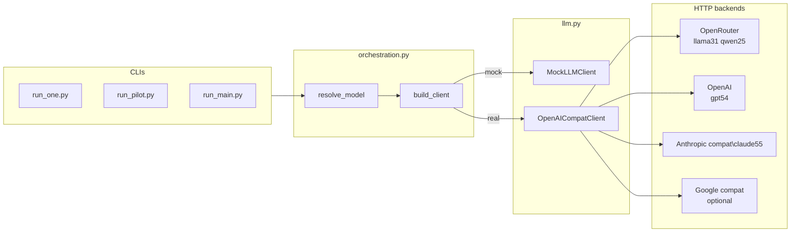

# Provider routing plan — OpenRouter + direct APIs

**Date:** 2026-07-14 · **Status:** **implemented** (see session log in `WORKING.md` §14) — C-05 `openrouter_provider.only` pin pending paid smoke  
**Charter:** `WORKING.md` §4 / §11 · Methods `03_Methods.tex` (OpenAI-compatible adapter, per-run `model_id` + endpoint logging)  
**Trigger:** Replace Together AI default for open-weight models with **OpenRouter**; keep **direct** provider APIs for proprietary models (OpenAI, Anthropic, Google).

---

## 1. Executive summary

The thesis codebase already routes all real models through a single **`OpenAICompatClient`** (`convention_topology/llm.py`) that calls `POST …/chat/completions` via the OpenAI Python SDK. Provider choice is **config-only** today (`config.yaml` → `ModelSpec.base_url` + `model_id` + `api_key_env`).

**Proposed routing (locked intent from user):**

| Model shorthand | Weight class | API route | Base URL | Key env var |
| --- | --- | --- | --- | --- |
| `llama31` | Open-weight | **OpenRouter** | `https://openrouter.ai/api/v1` | `OPENROUTER_API_KEY` |
| `qwen25` | Open-weight | **OpenRouter** | `https://openrouter.ai/api/v1` | `OPENROUTER_API_KEY` |
| `gpt54` | Proprietary | **OpenAI direct** | `https://api.openai.com/v1` | `OPENAI_API_KEY` |
| `claude55` | Proprietary | **Anthropic direct** (OpenAI-compat layer) | `https://api.anthropic.com/v1/` | `ANTHROPIC_API_KEY` |
| `gemini*` (optional / not in current 4-model factor) | Proprietary | **Google direct** (OpenAI-compat layer) | `https://generativelanguage.googleapis.com/v1beta/openai/` | `GEMINI_API_KEY` |
| `mock` | Offline | `MockLLMClient` | — | — |

**Minimal code delta:** mostly `config.yaml` + docs + `live/cost.py` price table. One **small** enhancement to `OpenAICompatClient` for OpenRouter optional headers and (recommended) provider-routing pins for reproducibility.

**Out of scope for this pass:** routing GPT/Claude/Gemini *through* OpenRouter (user explicitly wants direct APIs for proprietary models).

---

## 2. Current state (code audit)

### 2.1 Registry (`config.yaml`)

```yaml
llama31:
  model_id: meta-llama/Meta-Llama-3.1-70B-Instruct-Turbo
  base_url: https://api.together.ai/v1
  api_key_env: TOGETHER_API_KEY
qwen25:
  model_id: Qwen/Qwen2.5-72B-Instruct-Turbo
  base_url: https://api.together.ai/v1
  api_key_env: TOGETHER_API_KEY
gpt54:
  model_id: TBD-doug
  base_url: https://api.openai.com/v1
  api_key_env: OPENAI_API_KEY
claude55:
  model_id: TBD-doug
  base_url: https://api.anthropic.com/v1/
  api_key_env: ANTHROPIC_API_KEY
```

`WORKING.md` §13 #3 still lists Together as the open proposal; `IMPLEMENTATION_PLAN.md` §7.4 mirrors this.

### 2.2 Client construction

`orchestration.build_client()` always returns `OpenAICompatClient(...)` for non-mock models. No provider-specific branching — **good**: switching providers is a registry change, not a simulation change.

### 2.3 Sidecar logging (repro anchor)

Each run already records `model_id`, `endpoint_base_url`, `model_shorthand` in `.meta.json` (`persistence.py` / `run.py`). Methods lock satisfied as long as we pin exact strings in config and log them unchanged.

### 2.4 Known gap (pre-existing, not introduced by this plan)

`claude55` uses `OpenAICompatClient` → `chat.completions.create` against `https://api.anthropic.com/v1/`. This is **valid** only because Anthropic exposes an **OpenAI SDK compatibility layer** at that base URL (maps to native `/v1/messages` server-side). It is **not** the native Anthropic Messages SDK — acceptable for our simple system+user two-message flow; Anthropic docs mark it as test/compare, not long-term production. For thesis batch runs with fixed prompts, this is fine and matches the existing architecture.

**Do not** point `base_url` at `api.anthropic.com/v1/` and expect a raw `/v1/messages` client — our code does not implement that path.

---

## 3. Provider API reference (docs synthesis)

### 3.1 OpenRouter — open-weight models (`llama31`, `qwen25`)

| Item | Value |
| --- | --- |
| Docs | [Authentication](https://openrouter.ai/docs/api/reference/authentication) · [Chat completions](https://openrouter.ai/docs/api/api-reference/chat/send-chat-completion-request) · [Provider routing](https://openrouter.ai/docs/guides/routing/provider-selection) |
| Base URL | `https://openrouter.ai/api/v1` |
| Endpoint | `POST /chat/completions` (OpenAI-compatible) |
| Auth | `Authorization: Bearer $OPENROUTER_API_KEY` (keys prefixed `sk-or-`) |
| Model ID format | `provider/model-slug` (lowercase), e.g. `meta-llama/llama-3.1-70b-instruct`, `qwen/qwen-2.5-72b-instruct` |
| SDK usage | Official pattern: OpenAI Python SDK with `base_url` + `api_key` swap ([quickstart](https://openrouter.ai/docs/quickstart)) |
| Optional headers | `HTTP-Referer`, `X-OpenRouter-Title` (ranking/metadata on openrouter.ai — optional for thesis) |
| Routing | Default: load-balanced across backing hosts. For **reproducibility**, consider pinning via request body `provider` object (`only`, `order`, `allow_fallbacks: false`) — see §6.2 |
| Pricing (OR list, Jul 2026) | Llama 3.1 70B Instruct ≈ $0.40/$0.40 per 1M in/out; Qwen 2.5 72B Instruct ≈ $0.36/$0.40 per 1M ([model pages](https://openrouter.ai/meta-llama/llama-3.1-70b-instruct)) |

**Thesis mapping (proposed pins):**

| Shorthand | OpenRouter `model_id` | Notes |
| --- | --- | --- |
| `llama31` | `meta-llama/llama-3.1-70b-instruct` | Methods name “Meta-Llama-3.1-70B-Instruct”; slug is the reproducibility string |
| `qwen25` | `qwen/qwen-2.5-72b-instruct` | Methods name “Qwen2.5-72B-Instruct” |

Verify exact slugs once on [openrouter.ai/models](https://openrouter.ai/models) before C-05 smoke — slugs are stable but catalog can add variants (`-turbo`, quantizations).

### 3.2 OpenAI — `gpt54`

| Item | Value |
| --- | --- |
| Docs | [Chat Completions API](https://platform.openai.com/docs/api-reference/chat/create) |
| Base URL | `https://api.openai.com/v1` |
| Endpoint | `POST /chat/completions` |
| Auth | `OPENAI_API_KEY` (`sk-…`) |
| Model ID | **TBD with Doug** (`TBD-doug` placeholder; fail-fast today) — e.g. future `gpt-5.4` API id once released |
| Client | Existing `OpenAICompatClient` — no change |

### 3.3 Anthropic — `claude55`

| Item | Value |
| --- | --- |
| Native API | `POST https://api.anthropic.com/v1/messages` ([Messages API](https://platform.claude.com/docs/en/api/messages)) — **not** what our client calls today |
| OpenAI-compat path (what we use) | [OpenAI SDK compatibility](https://platform.claude.com/docs/en/api/openai-sdk): `base_url="https://api.anthropic.com/v1/"`, `ANTHROPIC_API_KEY`, `chat.completions.create(model="claude-…")` |
| Model ID | **TBD with Doug** — catalog shows ids like `claude-opus-4-8`, `claude-sonnet-4-6`; “Claude 5.5” string not in public docs yet |
| Constraints relevant to us | `max_tokens` required (we set 200); `temperature` capped at 1; system messages hoisted — fine for our `(system, user)` pair |
| **Do not** route via OpenRouter | User request: direct Anthropic billing + native provider relationship |

### 3.4 Google Gemini — optional / not in current 4-model factor

Not part of the locked Methods four-model factor today. Documented for completeness and Mehdizadeh-comparison context.

| Item | Value |
| --- | --- |
| Docs | [OpenAI compatibility](https://ai.google.dev/gemini-api/docs/openai) |
| Base URL | `https://generativelanguage.googleapis.com/v1beta/openai/` |
| Auth | `GEMINI_API_KEY` (or `GOOGLE_API_KEY` per Google docs — pick one env name in config) |
| Model ID examples | `gemini-3.5-flash`, etc. (verify at implementation time) |
| **Do not** route via OpenRouter | User request: Google handled via Google API |

If Gemini is added later: new registry entry `gemini*` + price row in `live/cost.py`; no new client class.

---

## 4. Architecture diagram



**Principle preserved:** simulation / analysis / DVs never branch on provider — only `LLMClient.complete(system, user)`.

---

## 5. Proposed `config.yaml` (target)

```yaml
models:
  llama31:
    provider: openrouter          # NEW: documentary + optional client behavior
    model_id: meta-llama/llama-3.1-70b-instruct
    base_url: https://openrouter.ai/api/v1
    api_key_env: OPENROUTER_API_KEY
    temperature: 0.5
    max_tokens: 200
    # optional — reproducibility pin (see §6.2):
    # openrouter_provider:
    #   allow_fallbacks: false
    #   only: ["together"]          # example: pin backing host if known stable

  qwen25:
    provider: openrouter
    model_id: qwen/qwen-2.5-72b-instruct
    base_url: https://openrouter.ai/api/v1
    api_key_env: OPENROUTER_API_KEY
    temperature: 0.5
    max_tokens: 200

  gpt54:
    provider: openai
    model_id: TBD-doug
    base_url: https://api.openai.com/v1
    api_key_env: OPENAI_API_KEY
    temperature: 0.5
    max_tokens: 200

  claude55:
    provider: anthropic
    model_id: TBD-doug
    base_url: https://api.anthropic.com/v1/
    api_key_env: ANTHROPIC_API_KEY
    temperature: 0.5
    max_tokens: 200

  # Optional future entry (not in current study design):
  # gemini35:
  #   provider: google
  #   model_id: gemini-3.5-flash
  #   base_url: https://generativelanguage.googleapis.com/v1beta/openai/
  #   api_key_env: GEMINI_API_KEY
  #   temperature: 0.5
  #   max_tokens: 200

  mock:
    provider: mock
    model_id: mock
    base_url: ""
    api_key_env: ""
    temperature: 0.5
    max_tokens: 200
```

`.env` example (never commit):

```bash
OPENROUTER_API_KEY=sk-or-...
OPENAI_API_KEY=sk-...
ANTHROPIC_API_KEY=sk-ant-...
# GEMINI_API_KEY=...   # only if gemini entry added
```

---

## 6. Code changes (planned — after go)

### 6.1 Config / types (`config.py`)

- Extend `ModelSpec` with optional `provider: str` and `openrouter_provider: dict | None` (parsed from YAML).
- `resolve_model()` unchanged fail-fast for `TBD-doug`.
- `config_hash()` includes new fields (not secret) so routing pins affect reproducibility fingerprint when set.

### 6.2 `OpenAICompatClient` (`llm.py`)

| Change | Rationale |
| --- | --- |
| When `base_url` host is `openrouter.ai`, pass optional `extra_headers` (`HTTP-Referer`, `X-OpenRouter-Title`) from env or constants | OpenRouter docs recommendation; low risk |
| When `openrouter_provider` dict present, pass `extra_body={"provider": …}` to `chat.completions.create` | Pin backing inference host for reproducibility ([provider routing](https://openrouter.ai/docs/guides/routing/provider-selection)) |
| No change for OpenAI / Anthropic / Google direct URLs | Already correct |

**Reproducibility note (decision needed):** OpenRouter’s default load balancing can change the backing GPU host between runs even with the same slug. Options:

1. **Accept slug-level pinning** — `model_id` + `endpoint_base_url=https://openrouter.ai/api/v1` in sidecar; document that sub-provider may vary (weakest repro).
2. **Pin `provider.only` after smoke** — e.g. lock to one stable backing provider slug from OR dashboard; store in `config.yaml` + `config_hash` (recommended for thesis).
3. **Disable fallbacks** — `allow_fallbacks: false` at minimum.

### 6.3 Orchestration (`orchestration.py`)

- Thread new `ModelSpec` fields into `OpenAICompatClient(...)`.
- No other logic changes.

### 6.4 Cost panel (`live/cost.py`)

Update `PRICE_TABLE_USD_PER_MILLION` keys to match new `model_id` strings:

```python
"meta-llama/llama-3.1-70b-instruct": (0.40, 0.40),
"qwen/qwen-2.5-72b-instruct": (0.36, 0.40),
```

Add rows when Doug pins GPT/Claude ids. Remove Together-specific ids.

### 6.5 Tests

| Test | Assert |
| --- | --- |
| `test_config.py` | `resolve_model(cfg,"llama31")` → OpenRouter URL + slug + `OPENROUTER_API_KEY` |
| `test_llm.py` | Stub transport: OpenRouter client sends `extra_body.provider` when configured |
| Existing suite | 150 tests remain green (mock path untouched) |

### 6.6 Documentation sync (same PR)

| File | Update |
| --- | --- |
| `WORKING.md` §4, §11, §13 #3 | OpenRouter default; retire Together proposal |
| `IMPLEMENTATION_PLAN.md` §7.4–7.5 | Registry table + `.env` example |
| `README.md` | Env var list |
| `01_Orga/Doug_Open_Questions.md` D2 | Mention OpenRouter for open models + direct keys for closed |
| `03_Methods.tex` | **Optional** one clause: “open-weight models via OpenRouter; proprietary via provider-native endpoints” — only if author wants Methods text change |

---

## 7. Methods / reproducibility alignment

Methods already require:

- Pinned `model_id` per run ✅ (sidecar field)
- Logged API configuration ✅ (`endpoint_base_url`)
- OpenAI-compatible adapter ✅ (OpenRouter is explicitly OpenAI-compatible)

**No Methods lock violation** if we:

1. Pin exact OpenRouter slugs in config before pilot.
2. Record them in every sidecar (already automatic).
3. Optionally pin OpenRouter sub-provider for stricter repro (§6.2).

**C-05 smoke checklist (post-implementation):**

```bash
# From repo root, with .env loaded:
python run_one.py --model llama31 --topology complete --k 1 --seed 0 --max-interactions 20 --smoke
python run_one.py --model qwen25  --topology complete --k 1 --seed 0 --max-interactions 20 --smoke
# After Doug pins:
# python run_one.py --model gpt54 ...
# python run_one.py --model claude55 ...
```

Verify sidecar: `endpoint_base_url`, `model_id`, token usage in events.

---

## 8. Decisions needed before implementation (your go)

| # | Question | Recommendation |
| --- | --- | --- |
| D-OR-1 | Pin OpenRouter backing provider after smoke, or accept slug-only repro? | **Pin** `provider.only` once stable host identified |
| D-OR-2 | Add optional OpenRouter ranking headers (`HTTP-Referer`, `X-OpenRouter-Title`)? | Yes — set to thesis repo URL / “TUM Master Thesis” |
| D-OR-3 | Add `provider` field to YAML (documentary) or keep URL-only inference? | **Add** `provider` — clearer for Doug / Methods appendix |
| D-OR-4 | Register a `gemini*` model now or defer? | **Defer** — not in locked 4-model factor |
| D-OR-5 | Update `03_Methods.tex` prose to name OpenRouter? | Your call — technically optional (endpoint is logged) |
| D-OR-6 | Retire Together entirely or keep as commented fallback in config? | **Retire** — single SSOT per model |

---

## 9. Implementation checklist (execute only after go)

- [ ] Update `config.yaml` registry (§5)
- [ ] Extend `ModelSpec` + `resolve_model` + `config_hash`
- [ ] Enhance `OpenAICompatClient` (OpenRouter headers + optional `provider` body)
- [ ] Update `build_client` wiring
- [ ] Update `live/cost.py` price keys
- [ ] Adjust `tests/test_config.py`, `tests/test_llm.py`
- [ ] Sync `WORKING.md`, `IMPLEMENTATION_PLAN.md`, `README.md`, `Doug_Open_Questions.md`
- [ ] Run full test suite + offline smokes
- [ ] C-05: paid smoke `llama31` + `qwen25` via OpenRouter (manual, post-keys)

**Estimated diff:** ~150–250 LOC including tests and docs — no simulation/analysis changes.

---

## 10. Risks & mitigations

| Risk | Mitigation |
| --- | --- |
| OpenRouter sub-provider drift | Pin `provider.only` after pilot smoke; log full request metadata if OR returns provider in response (investigate during smoke) |
| Model slug typo | Fail fast on 404 at smoke; verify against OR catalog |
| Anthropic compat limitations (no prompt caching, etc.) | Irrelevant to our protocol; already accepted architecture |
| Rate limits differ by route | Keep `--workers ≤ 4` per provider; OpenRouter has its own limits — tune after smoke |
| Cost estimates wrong | Refresh `PRICE_TABLE` from OR model pages at implementation |

---

## 11. References

- OpenRouter: https://openrouter.ai/docs/quickstart · https://openrouter.ai/docs/api/reference/authentication · https://openrouter.ai/docs/guides/routing/provider-selection
- OpenAI Chat Completions: https://platform.openai.com/docs/api-reference/chat/create
- Anthropic OpenAI SDK compat: https://platform.claude.com/docs/en/api/openai-sdk · Native Messages: https://platform.claude.com/docs/en/api/messages
- Google Gemini OpenAI compat: https://ai.google.dev/gemini-api/docs/openai
- Thesis code: `config.yaml`, `convention_topology/config.py`, `convention_topology/llm.py`, `convention_topology/orchestration.py`, `live/cost.py`
